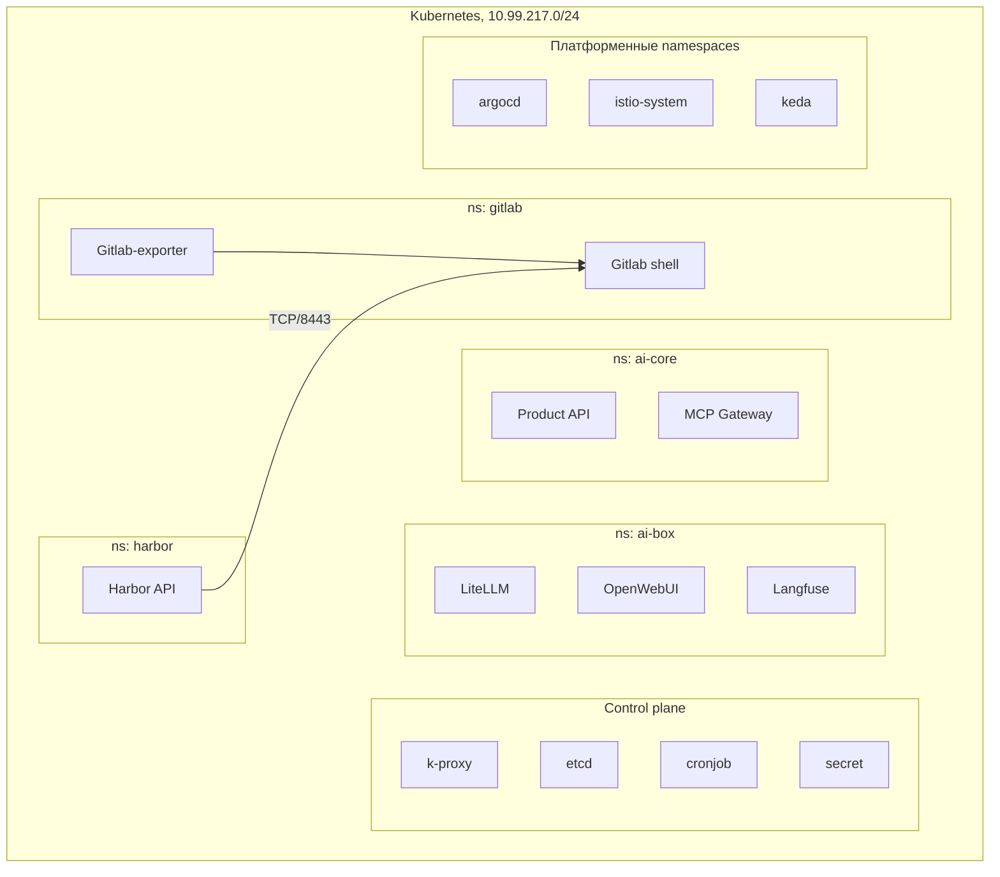

Страница показывает, что где запущено в кластере. Данные взяты со схемы кластера; назначение отдельных компонентов на схеме не указано, поэтому описаний нет.

## Диаграмма

На диаграмме показана часть компонентов. Полный список — в таблице.

## Namespace → компоненты

| Namespace | Компоненты |
|-----------|------------|
| `gitlab` | Gitlab shell, Gitlab-exporter (домен gitlab.geotech.in) |
| `harbor` | Harbor API (TCP/8443) |
| `ai-box` | LiteLLM, OpenWebUI, deepagent, Presidio, Langfuse, HeadRoom, Caddy |
| `ai-core` | Adapter, Product API, Aegra / Deep Agents, DeepAgents, Terminal Brigde, MCP Gateway |
| `analytics-box` | Daytona API, Proxy, Runners |
| `argocd` | argocd |
| `istio-system` | Istio-base, Istio-cezr-ingress, Istio-infra-ingress, Istio-ingressgateway, Istiod, kiali-server |
| `keda` | keda |
| `external-dns` | external-dns, external-secret |
| `falco` | falco |
| `nvidia` | nvidia-operator, nvidia-smi |
| `polaris` | polaris |
| `wazuh` | wazuh-agent, wazuh-indexer, wazuh-master, wazuh-dashboard, wazuh-worker1, wazuh-worker2; рядом на схеме kyverno |
| `dex` | dex, dex-auth |
| `grafana-logs` | grafana, loki, victoria-metrics, Prometheus |
| `n8n` | n8n (два экземпляра) |
| `cert-manager` | cert-manager, cert-manager2 |
| `keycloak` | keycloak |

::note
Названия `Istio-cezr-ingress` и `Terminal Brigde` переписаны со схемы как есть. Уточнить написание. Kyverno нарисован внутри блока wazuh, но отдельного namespace не имеет, уточнить.
::

## Control plane

На схеме вне namespaces показаны: `k-proxy`, `etcd`, `cronjob`, `secret`, а также значок control plane. Подробнее — в [Kubernetes](/devops-arhitektura/kubernetes).
