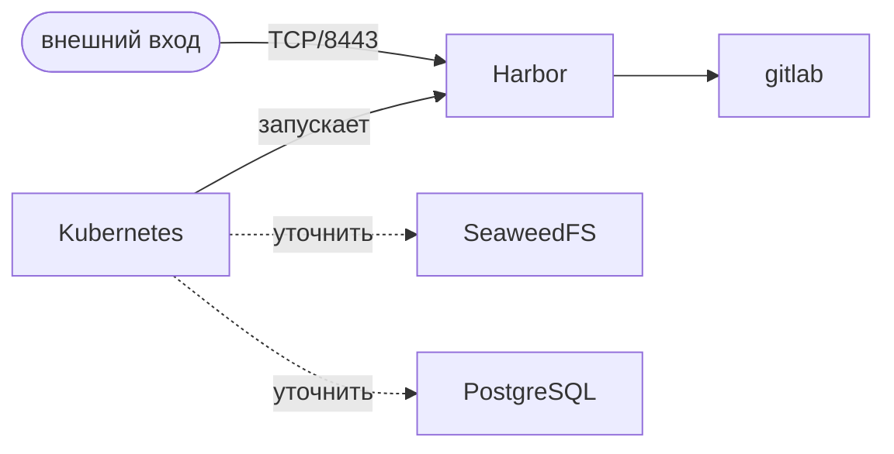

Страница даёт карту стека: что за что отвечает и как компоненты связаны. Детали — на страницах компонентов, список namespaces — в [Кластер и namespaces](/devops-arhitektura/klaster).

::warning
**Раздел собран по одной схеме кластера.** На схеме нет SeaweedFS и PostgreSQL, поэтому всё, что о них сказано, помечено «уточнить» и ждёт данных от команды DevOps.
::

## Роли компонентов

| Компонент | Роль | Что известно |
|-----------|------|--------------|
| [Kubernetes](/devops-arhitektura/kubernetes) | Оркестрация, внутренняя сеть `10.99.217.0/24` | Есть на схеме |
| [Harbor](/devops-arhitektura/harbor) | Реестр образов, API на TCP/8443 | Есть на схеме |
| [SeaweedFS](/devops-arhitektura/seaweedfs) | Хранилище | Нет на схеме, уточнить |
| [PostgreSQL](/devops-arhitektura/postgresql) | База данных | Нет на схеме, уточнить |

## Связи

Сплошные связи взяты со схемы. Пунктирные — предположение о месте компонентов в стеке, уточнить.

## Дальше

::card-group
  ::card{title="Кластер и namespaces" icon="i-lucide-boxes" to="/devops-arhitektura/klaster"}
  Диаграмма кластера и таблица namespace → компоненты.
  ::
  ::card{title="Kubernetes" icon="i-lucide-container" to="/devops-arhitektura/kubernetes"}
  Control plane и внутренняя адресация.
  ::
  ::card{title="Harbor" icon="i-lucide-package" to="/devops-arhitektura/harbor"}
  Реестр образов и его связь с GitLab.
  ::
::
